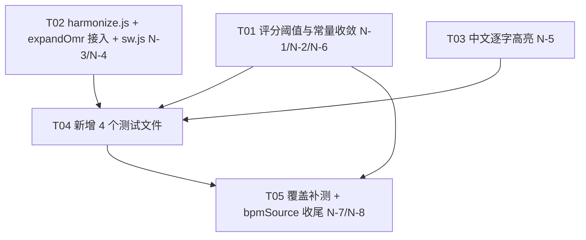

# V4.2.4 增量设计 + 冲突分析报告

> 作者：高见远（架构师） · 基线：V4.2.3（commit `9c161c8`）
> 依据：`docs/SONGBOOK_TEST_MANUAL.md`（N-1..N-8 + §4.1）
> 性质：**只做设计与冲突分析，未改动任何代码文件**
> 说明：本报告中所有数字均为在基线上**实测**得到（命令见 §1.2），凡手册结论与实测不符处已在 §3 逐条标出。

---

## 0. 先看这里：三个「手册没写但必做」的动作

| # | 必做动作 | 不做会怎样 | 归属 |
|---|---|---|---|
| **A** | 新增 `assets/js/gp/harmonize.js` 后，**必须同步在 `sw.js` 预缓存清单插入一行** | `test/gp-play.test.js` 的 **GP-6 直接红**（该用例用 `readdirSync(assets/js/gp)` 断言每个 `.js` 都在 sw.js 里） | T02 |
| **B** | N-5 改 `karaoke-timeline.js` 的同时，**必须改 `karaoke-render.js:24` 的 `.join(" ")`** | 中文歌词渲染成「长 亭 外 古 道 边」，逐字高亮修好了但版面被空格撑坏 | T03 |
| **C** | N-3 给 24 首真实谱补上 `harmony` 后，**必须补一个消费端** | `song.harmony` 全项目**零读取方**，用户可见收益为 **0**，§6.2 人工验收「左下角显示 G/Em」无法达成 | T05（需拍板） |

另有 4 处手册结论与实测不符，见 §3.1。

---

## 1. 基线复现（实测，非转述手册）

### 1.1 环境

```
HEAD     = 9c161c8（V4.2.3），工作区仅多出未跟踪文件 docs/SONGBOOK_TEST_MANUAL.md
npm test = 337 项 / 336 通过 / 0 失败 / 1 跳过
源文件   = 62 个（assets/js 下全部 .js）
测试文件 = 35 个
```

### 1.2 关键复现命令与实测输出

| 项 | 命令 | 实测结果 |
|---|---|---|
| N-1 off 不可达 | `Grader` + 10×`observe(n, 60.7)` | `frames=undefined best=undefined` → `finalize()='miss'`，`counts={perfect:0,good:0,off:0,miss:1}` ✅ 手册属实 |
| N-6 倍率上限 | 40 次 perfect | `streak=40 mult=2.5` ✅ 手册属实 |
| N-3 真实谱无 harmony | 遍历 `GP_CHORD_SONGS` 取 `chartKind==='omr'` | `真实谱 24 首；有 harmony 的 0 首` ✅ |
| N-4 派生成功率 | `deriveHarmony` 跑 56 条 OMR | `成功 32 失败 24` ✅ |
| N-7 bpmSource | 统计 `findSong().bpmSource` | `{fallback-tier:17, (undefined):207, derived-omr:7}` ✅ |
| 覆盖矩阵 | 手册 §2.3 脚本原样执行 | `源文件总数 62`，`无专项测试模块: 28` ✅ 总数属实，**但成员名单与手册表不一致**（见 §3.1） |
| grader 零引用 | `grep -rn "grader" --include=*.js/.html/.mjs` | 除自身外**无任何输出** ✅ |
| harmonize 算法实测 | 把手册 §4.1 代码原样落地跑真实数据 | HM-1 `C-E-G→[0,'maj']`、HM-2 `G-B-D→[7,'maj']`、HM-3 `A-C-E→[9,'min']`、HM-4 空小节沿用 `[7,'maj']` **全部与手册声明一致**；全量 `harmonizeOmr` 跑 56 条 OMR → **成功 56/56** ✅ |
| OMR 拍位网格 | 扫描 6937 个事件 | `beat>=span overflow=0`，非 `0/.25/.5/.75` 的小数 `other fractions=0` ✅ `onBeat` 判定安全 |
| 歌词分词影响面 | 扫描 12053 行歌词 | 含 CJK **9514** 行 / 纯拉丁 **2539** 行 / 含标点 **853** 行 / **自带 `words` 0 行** |
| 逐字时长极值 | 按手册算法模拟 | **max 14.77 s/字**（《玫瑰窃贼》「带走我」）、**min 0.001 s/字**（108 字版权行）；`>1.5s` 的行 **248** 条，`<0.08s` 的行 **295** 条 |
| 调性数据 | 统计 `def.key` | **231 首全部 `key:'C'`**（`keyToPc(def.key)` 恒为 0）⚠️ |

---

## 2. 逐项修复方案（N-1 .. N-8）

### N-1【P0】`grader.js` off 判定不可达

**决策（先回答要不要接入 play.js）**

> **结论：保留 `grader.js` 为公共库，本轮「只修 bug + 补测试 + 收编常量」，不替换 play.js 内联评分；但必须消灭同源双实现。**

理由：

1. **替换的风险远大于收益。** `play.js` 的 `finalize()/applyJudgment()` 与 DOM 强耦合（`pushKill()` 写 killfeed、`toast()`、`updateHud()`、`Store.addHistory`），还分「打击乐（秒）/ 旋律（cents）」两套语义，外加 `singalongOnly` 不判分分支。把 `Grader` 塞进去等于一次演奏主循环重构，一旦回归就是 P0 线上事故；而收益仅是「少一份 if/else」。
2. **保留为公共库是真需求。** `grader.js` 导出 `centsOff / classify / gradeLetter / vocalTargets`，注释里明确写「instrument play **and karaoke vocal scoring**」——它本来就是为未来跟唱评分预留的公共件，死代码是「未被接线」，不是「设计错误」。
3. **但双实现必须收敛。** 实测发现 **`play.js:775-782` 的 `gradeLetter` 与 `grader.js:101-108` 逐字节相同**，且 `PERFECT_CENTS/GOOD_CENTS`（play.js:21-22）与 `GRADE_DEFAULTS` 也是重复定义。这种「两份一样的代码」正是 N-1/N-2 同源 bug 的温床，必须让 play.js **从 grader.js 导入**常量与 `gradeLetter`，保证单点定义。

风险与兜底：
- 风险：`play.js` 新增 `import` 后若 `grader.js` 抛错，演奏页整体不可用。兜底：`grader.js` 是**零 DOM 依赖纯函数**（已实测可在 Node 裸 import），风险极低。
- 风险：后续有人只改一处。兜底：新增测试 `test/gp-grader.test.js` 断言「`play.js` 与 `grader.js` 的阈值/等级常量一致」（用源码文本断言，见 T04）。

**改动 1 — `assets/js/gp/grader.js:55-62`**

```js
// 改前
  observe(note, detectedMidi) {
    if (!(detectedMidi > 0)) return;
    const cents = centsOff(detectedMidi, note.midi);
    if (cents < this.opt.goodCents) {          // ← 只在 <60 时计帧，off 永不可达
      note.frames = (note.frames || 0) + 1;
      if (cents < (note.best ?? Infinity)) note.best = cents;
    }
  }

// 改后
  observe(note, detectedMidi) {
    if (!(detectedMidi > 0)) return;
    const cents = centsOff(detectedMidi, note.midi);
    /* N-1：半音（100 cents）以内都算「有输入」，分级交给 classify()。
       旧实现用 goodCents(60) 兜门，导致 frames>=1 ⟹ best<=60，
       与 classify 的 off 分支（要求 best>60）逻辑互斥，off 永不可达。 */
    if (cents < this.opt.observeCents) {
      note.frames = (note.frames || 0) + 1;
      if (cents < (note.best ?? Infinity)) note.best = cents;
    }
  }
```

**改动 2 — `assets/js/gp/grader.js:8-13`（新增 `observeCents`，并把倍率改成导出函数，见 N-6）**

```js
export const GRADE_DEFAULTS = {
  perfectCents: 28,
  goodCents: 60,
  /* N-1：观察窗口 = 1 个半音。与 classify 的 off 上界同源，勿单独调。 */
  observeCents: 100,
  health: { start: 100, max: 100, perfect: +6, good: +3, off: -7, miss: -10 },
  score: { perfect: 100, good: 60, off: 10 },
};
```

> ⚠️ 坑：`GRADE_DEFAULTS` 被 `classify(frames, bestCents, opt = GRADE_DEFAULTS)` 当默认值用，新增字段不影响既有签名，向后兼容。

---

### N-2【P0】`play.js` 的 off 判定同样不可达 + 打击乐分支不一致

**改动 1 — `assets/js/gp/play.js:389`**

```js
// 改前
        if (bestCents < GOOD_CENTS) { n.frames++; if (bestCents < n.best) n.best = bestCents; }

// 改后
        /* N-2：同 N-1，观察窗口放宽到 1 个半音，off 才可达（半音外仍算 miss） */
        if (bestCents < OFF_CENTS) { n.frames++; if (bestCents < n.best) n.best = bestCents; }
```

**改动 2 — `assets/js/gp/play.js:20-23`（常量改为从 grader.js 收编）**

```js
// 改前
const HIT_PAD = 0.16;         // detection window pad around a note
const PERFECT_CENTS = 28;
const GOOD_CENTS = 60;

// 改后
import { GRADE_DEFAULTS, comboMult, gradeLetter as gradeLetterOf } from "./grader.js";
const HIT_PAD = 0.16;         // detection window pad around a note
/* N-1/N-2：阈值与 grader.js 同源单点定义，禁止在此处再写魔数 */
const PERFECT_CENTS = GRADE_DEFAULTS.perfectCents;   // 28
const GOOD_CENTS    = GRADE_DEFAULTS.goodCents;      // 60
const OFF_CENTS     = GRADE_DEFAULTS.observeCents;   // 100
```

**改动 3 — `assets/js/gp/play.js:775-782`（删除本地 `gradeLetter`，改为 re-export/直接引用）**

```js
// 改前
function gradeLetter(acc, failed) { if (failed) return "F"; ... return "F"; }

// 改后
/* N-1：与 grader.js 的 gradeLetter 曾逐字节重复 → 统一为单一实现 */
const gradeLetter = gradeLetterOf;
```

**关于打击乐分支（L365）是否需要对齐 —— 结论：不对齐，但要写清**

- 打击乐 `n.best` 存的是**秒**（`Math.abs(best.time - onsetAt)`），旋律 `n.best` 存的是 **cents**，两者量纲不同，本来就不是同一套阈值，`GOOD_CENTS` 对打击乐无意义。
- 打击乐的 `frames++` 无条件累加是**有意为之**：候选搜索窗口是 `[n.time - HIT_PAD, n.time + n.dur + HIT_PAD]`，能进入这个窗口的 onset 说明「你确实敲了」，只是早晚问题；`finalize` 再用 0.07s / 0.15s 分 perfect/good/off。这是正确语义。
- 旋律分支不能照抄「无条件累加」：那样任何环境噪声（RMS 过门但音高完全不相关）都会计帧并把 miss 抬成 off，等于**变相降低 miss 惩罚**。保持「半音内才计帧」是对的。
- **唯一要做的**：把这段不对称写成注释，避免后人误当 bug。建议在 `grade()` 上方补：

```js
  /* 分支语义差异（有意保留，勿对齐）：
     · 打击乐：onset 落在窗口内即计帧，n.best 单位=秒，用 0.07/0.15 分级；
     · 旋律  ：需 bestCents < OFF_CENTS 才计帧，n.best 单位=cents，用 28/60 分级。
     两者量纲不同，阈值不可互换。 */
```

**N-1/N-2 的回归面（实测结论，重点）**

改 100 之后，被「从 miss 重新判为 off」的音符，其影响是：

| 指标 | 变化 | 说明 |
|---|---|---|
| `accuracy()` | **完全不变** | `(perfect + good*0.6)/total`，off 与 miss 都只在分母、分子均为 0；总数不变 |
| `passed` | **完全不变** | `!failed && acc >= 60` |
| `health` | -10 → **-7** | 血条变慢（这正是修复目的） |
| `score` | +0 → **+10** | 微小上升 |
| `streak`/`mult` | 不变 | off 与 miss 都 `streak = 0` |

→ **结论：判定语义变了，但准确率/通关口径零影响，回归风险集中在「血量/分数」且无任何既有断言覆盖（见 §3.2）。**

---

### N-3【P0】24 首真实谱无 `harmony`

**根因确认**：`catalog.js` 的 `expandChord()` 在 L259-262 派生、L302 写 `song.harmony`；`expandOmr()`（L318-365）只写 `loopInfo / bpmSource / bpmEffective`，**从未写 `harmony`**。

**改动 — `assets/js/gp/catalog.js`，在 `expandOmr()` 的 `song.loopInfo = q.loopInfo;`（L361）之前插入**

```js
  /* N-3/N-4：真实谱同样需要和弦进行——否则弹唱左下角只能显示单音音名（G3/B3）。
     优先用「音簇识别」（有真实音簇证据）；单音旋律退化为「旋律配和弦」（推算）。
     两者 source 不同，UI/审计可据此区分证据强度（严禁混为一谈）。 */
  const keyPc = keyToPc(def.key || 'C') ?? 0;
  const bpb = omr.b || 4;
  let harmony = deriveHarmony(omr, bpb, { keyPc });
  if (!harmony.chords.length) harmony = harmonizeOmr(omr, bpb, { keyPc });
  song.harmony = harmony.chords.length
    ? {
        source: harmony.source,                 // 'derived-omr' | 'harmonized-melody'
        chords: harmony.chords,                 // 相邻去重后的进行（序列）
        barChords: harmony.barChords || null,   // 逐小节和弦（供演奏视图按小节显示）
        beatsPerBar: bpb,
        uncertainBars: harmony.uncertainBars,
      }
    : { source: 'template', chords: [[keyPc, 'maj']], barChords: null, beatsPerBar: bpb, uncertainBars: [] };
```

需要在文件头补 `import { harmonizeOmr } from './harmonize.js';`（L15 附近）。

> ⚠️ 必须补 `barChords`：见 §3.4 —— `chords` 是**去重后的进行序列**，长度 ≠ 小节数（实测《送别》16 小节 → 10 个和弦），演奏视图若按 `chords[i % len]` 取会和谱面错拍。

---

### N-4【P1】新增 `assets/js/gp/harmonize.js`（单音旋律配和弦）

**算法复核结论：手册 §4.1 的打分函数在「本项目真实数据结构」下可用，但需 4 处加固。**

已复核通过的项：

| 复核点 | 结论 |
|---|---|
| `onBeat = Math.abs(beat % 1) < 0.01` | ✅ 安全。6937 个事件的拍位**全部落在 `0 / .25 / .5 / .75`**，无 `0.333` 之类三连音、`beat % 1` 只有 0/.25/.5/.75 四种值，判定`< 0.01` 精确命中整拍，不会误判也不会漏判 |
| `bars = Math.max(1, Math.ceil(span / bpb))` | ✅ 安全。6937 个事件中 `beat >= span` 的 **0 个**，不存在「尾部音符被 `b >= bars` 丢弃」。但 `span=0` 时 `bars=1`，需保留 `Math.max(1, ...)`（代码已有） |
| 空小节返回 `prev` 的连锁 | ✅ 语义正确，但有**两处隐患**（见下） |
| `CHORD_TYPES.maj/min/dim.intervals` | ✅ `[0,4,7]/[0,3,7]/[0,3,6]`，与打分函数接口匹配 |
| 全量收益 | ✅ 实测 `harmonizeOmr` 跑 56 条 OMR → **56/56 全部产出非空 chords**（《送别》16 小节→10 和弦 `C G C G C F G C G C`；《稻香》118 小节→31 和弦） |

**必须加固的 4 处：**

**(1) 空小节返回 `prev` 会共享同一个数组引用（别名 bug）**

```js
// 手册原文
if (!melody.length) return prev;
```
`harmonizeOmr` 里 `raw.push(prev)` 会把同一对象 push 多次，后续若有人 `chords[i][0] = x` 就地改值，会一次性污染所有空小节。`chords` 的相邻去重是**按值**比较，所以当前不出错，但属于定时炸弹。

```js
// 加固后
  if (!melody.length) return prev ? [prev[0], prev[1]] : null;   // 断引用，避免共享数组
```

**(2) `chords` 丢失小节对齐 → 必须同时返回 `barChords`**

```js
  return {
    chords,            // 相邻去重后的进行（审计/展示序列）
    barChords: raw,    // ← 新增：逐小节和弦，长度 === bars，供演奏视图按下标取
    bars, uncertainBars: [], source: 'harmonized-melody',
  };
```

**(3) 全曲无音符时 `chords` 为空 → 必须让调用方有兜底**

实测：`harmonizeOmr({span:16, b:4, n:[]})` → `chords=[]`。N-3 的调用代码已用 `harmony.chords.length ? ... : template` 兜底 ✅，但 `deriveHarmony` 也返回 `chords=[]`，两条路径都要兜（上面 N-3 的代码已统一处理）。

**(4) `barChords` 中的 `null` 前导空小节**

曲子开头若连续空小节，`raw[0..k] = null`。`harmonizeBar` 首小节失败时应 fallback。建议在 `harmonizeOmr` 末尾对齐 `deriveHarmony` 的既有策略（用首个成功和弦回填）：

```js
  const first = raw.find(Boolean);
  if (first) for (let b = 0; b < bars; b++) if (!raw[b]) raw[b] = [first[0], first[1]];
```

**文件落地位置：`assets/js/gp/harmonize.js`（新增）**，内容以手册 §4.1 为基准 + 上述 4 处加固。

> ⚠️ **必须同步 `sw.js`**（见 §0-A）：在 `sw.js:99` `'./assets/js/gp/harmony.js',` 之后插入 `'./assets/js/gp/harmonize.js',`，否则 GP-6 红。

---

### N-5【P1】中文歌词逐字高亮失效

**改动 1 — `assets/js/gp/karaoke-timeline.js:26`（分词）**

手册给的 `tokenizeLine` 基本可用，但按实测数据（9514 行 CJK / 2539 行纯拉丁 / 853 行含标点 / **最长行 108 字**）需加固为「分段（run）分词」：

```js
const CJK = /[\u4e00-\u9fff\u3040-\u30ff\uac00-\ud7af]/;
const PUNCT_ONLY = /^[\p{P}\p{S}\s]+$/u;

/* N-5：中/日/韩无空格，按字切分；拉丁/数字连续段整体作为一个词；
   纯标点段丢弃（不给它分配时间片）。 */
export function tokenizeLine(text) {
  const s = String(text || "").trim();
  if (!s) return [];
  if (!CJK.test(s)) return s.split(/\s+/).filter(Boolean);   // 纯拉丁：保持原行为（KT-3）
  const out = [];
  for (const ch of s) {
    if (/\s/.test(ch)) continue;
    if (PUNCT_ONLY.test(ch)) continue;                        // 标点不占时间片
    out.push(ch);
  }
  return out;
}
const tokens = tokenizeLine(line.text);                      // 替换原 L26
```

> 为什么不能像手册那样「含 CJK 就整行按 `[...s]` 逐字切」：实测最长行是 108 字的版权行
> `OP(原属词曲版权公司)：Warner Chappell Music, Hong Kong Limited Taiwan Branch/...`
> —— 含 CJK 会触发逐字切分，把 `Warner` 拆成 `W a r n e r` 六个 token。分段分词可避免。
> （该行本身也是残留的版权元数据行，`GP-1` 的正则 `^\s*OP\s*[:：]` 因 `OP(` 带括号而漏网；属既有问题，本轮不处理，仅登记。）

**改动 2 — `assets/js/gp/karaoke-timeline.js:28-36`（时长分配必须加上下限保护）**

手册说「单字权重恒为 1 → 均匀分配 → 符合中文演唱节奏」，但**实测不成立**：

- 最长 **14.77 s/字**（《玫瑰窃贼》「带走我」3 字占了 44 秒空档）
- 最短 **0.001 s/字**（108 字的版权行）
- `>1.5s/字` 的 **248 行**，`<0.08s/字` 的 **295 行**

前者一个字亮半天，后者一帧闪过（<5 帧），都不是「符合演唱节奏」。加固方案：

```js
const MIN_WORD_DUR = 0.12;   // 低于 1 帧×2 的字会闪，抬到可感知
const MAX_WORD_DUR = 1.20;   // 单字超过 1.2s 说明该行是长空档，别让它独占

/** 按权重把 span 分配给 n 个词，并夹紧到 [MIN,MAX]，迭代重分配保持总和=span（保证首尾衔接） */
function allocate(weights, span) {
  const n = weights.length;
  const total = weights.reduce((a, b) => a + b, 0) || n;
  if (span < n * MIN_WORD_DUR) return new Array(n).fill(span / n);   // 极端：放弃下限，保证不溢出
  const durs = weights.map((w) => (span * w) / total);
  for (let pass = 0; pass < 6; pass++) {
    let sum = 0, free = 0;
    for (let i = 0; i < n; i++) {
      durs[i] = Math.min(MAX_WORD_DUR, Math.max(MIN_WORD_DUR, durs[i]));
      sum += durs[i];
      if (durs[i] > MIN_WORD_DUR + 1e-9 && durs[i] < MAX_WORD_DUR - 1e-9) free += durs[i];
    }
    const drift = span - sum;
    if (Math.abs(drift) < 1e-6 || free <= 0) break;
    const f = (free + drift) / free;
    for (let i = 0; i < n; i++) {
      if (durs[i] > MIN_WORD_DUR + 1e-9 && durs[i] < MAX_WORD_DUR - 1e-9) durs[i] *= f;
    }
  }
  return durs;
}
```

`normalizeWords` 中替换分配逻辑（保持 `t` 累加 → **KT-2 的首尾衔接天然成立**）：

```js
  const durs = allocate(weights, span);
  let t = start;
  return tokens.map((tok, i) => {
    const dur = durs[i];
    const w = { t: +t.toFixed(3), end: +(t + dur).toFixed(3), dur: +dur.toFixed(3), text: tok };
    t += dur;
    return w;
  });
```

> 注：`MIN_WORD_DUR` 的兜底分支（`span < n*MIN`）会让词尾溢出到下一行起点之前一点点；`activeAt`/`timelineDuration` 只认 `line.end`，不受影响。

**改动 3 — `assets/js/gp/karaoke-render.js:24`（配套必改，手册遗漏）**

```js
// 改前
  }).join(" ");

// 改后
  }).join(needsSpace(line) ? " " : "");      // N-5：CJK 词间不插空格
```

```js
const CJK_RE = /[\u4e00-\u9fff\u3040-\u30ff\uac00-\ud7af]/;
/** 行内含 CJK 时词间不加空格，否则「长亭外」会渲染成「长 亭 外」 */
function needsSpace(line) {
  const words = line && line.words;
  if (!words || !words.length) return true;
  return !words.some((w) => CJK_RE.test(w.text || ""));
}
```

**N-5 的三个「会不会影响」——逐条结论**

| 关注点 | 结论 | 依据 |
|---|---|---|
| `songDuration`（`song-format.js:113`） | **不受影响** ✅ | 它只用 `l.time / l.dur / next.time`，**完全不读 `words`**；`LYRIC_DEFAULT_DUR=3` 也不变。改前后 `songDuration` 逐曲同值 |
| `hasWordTiming`（`karaoke-timeline.js:59`） | **不受影响（仍为 false）** ✅ | 判定式是 `raw.some(l => Array.isArray(l.words) && l.words.length)`，只取决于**输入歌词**是否自带 `words`。实测 **12053 行中自带 `words` 的 0 行** → 改前后恒 `false`。且该字段**全项目无消费方**（仅定义），所以 KT-5 只要保证「给了 words 就保留」即可 |
| `karaoke-render.js` 渲染 | **受影响，必须同步改** ⚠️ | 见改动 3；且 `lineFillHTML` 唯一消费方是 `play.js:616` |

**必须回归的测试点**

1. `test/gp-play.test.js` GP-2：`songDuration` 落在 `30 < dur < 400` —— 应逐曲快照对比改前后（建议加一条「改前后 songDuration 同值」的断言）。
2. `tools/diagnose-songbook.mjs` BUG-11：`cutList.length === 0`（歌词末时间 vs `songDuration`）—— 因 `songDuration` 不变，应保持 0。
3. `test/gp-play.test.js` GP-4：`.lyric-line` 存在、挂载/teardown 不抛错。
4. `test/gp-css-contract.test.js` CSS-3/5：宿主补丁里 `.kw.cur` 规则与 `.gp-scope` 前缀（本轮不改 CSS，仅确认不被牵连）。
5. `test/gp-i18n.test.js` GP-XSS-3：`escapeHTML` 覆盖 `& < > " '`。
6. 新增 `test/gp-karaoke-timeline.test.js`（KT-1..KT-6），其中 **KT-6 为新增**：CJK 行经 `lineFillHTML` 渲染后**不含词间空格**。

---

### N-6【P2】连击倍率上限实为 2.5

**产品决策建议：保持 2.5，并在两处写清；同时把公式抽成单一函数。**

理由：
- 改成 `Math.min(4, ...)`（→3.0）会**直接放大所有曲目得分**，而 `coins = max(1, round(score/100))` 与练习时长/奖励挂钩，属于**经济系统变更**，不应由一个「文档措辞歧义」驱动。
- 实测两侧表达式完全相同，说明原始意图就是同一套数值，2.5 是「实现与意图一致」，只是文档未写明。
- 若产品方确实想要 3.0，应作为**独立需求单独评估**（含金币产出影响），不与本轮缺陷修复混在一起。

**改动（两处强制一致）**

```js
// assets/js/gp/grader.js —— 新增导出
/**
 * N-6：连击倍率。⚠️ 上限为 2.5（非 3.0）：
 *   streak 8→1.5x, 16→2.0x, 24→2.5x, ≥32 恒 2.5x（Math.min(3, ...) 封顶在 3 个档位）。
 *   改此公式会同步影响 score 与 coins = round(score/100)，须单独走产品评审。
 */
export function comboMult(streak) {
  return 1 + Math.min(3, Math.floor((streak || 0) / 8)) * 0.5;
}
```

```js
// grader.js:80
-    this.mult = 1 + Math.min(3, Math.floor(this.streak / 8)) * 0.5;
+    this.mult = comboMult(this.streak);

// play.js:423
-    mult = 1 + Math.min(3, Math.floor(streak / 8)) * 0.5;
+    mult = comboMult(streak);
```

验收断言应为**精确等值**，不要写成 `<= 3`（手册 GR-8 的 `assert.ok(g.mult <= 3)` 在 2.5 与 3.0 两种决策下都通过，是**无效断言**，建议改为 `assert.strictEqual(g.mult, 2.5)`）：

```js
test('GR-8 倍率上限为 2.5（非 3.0），且与 play.js 同式', () => {
  const g = new Grader();
  for (let i = 0; i < 40; i++) { const n = { midi: [60] }; g.observe(n, 60); g.observe(n, 60); g.finalize(n); }
  assert.strictEqual(g.mult, 2.5);
  assert.strictEqual(comboMult(32), 2.5);
  assert.strictEqual(comboMult(8), 1.5);
  const playSrc = readFileSync(new URL('../assets/js/gp/play.js', import.meta.url), 'utf8');
  assert.ok(!/Math\.min\(3,\s*Math\.floor\(streak/.test(playSrc), 'play.js 不得再内联倍率公式');
});
```

---

### N-7【P2】`bpmSource` 覆盖不一致（207 首 undefined）

**建议落在 `expandChord()` 显式赋值，而不是 `newSong()` 加默认值。**

理由：`newSong()` 位于 `song-format.js`，是**通用 schema 构造器**，加 `bpmSource` 会把「曲库展开侧的审计字段」泄漏进通用数据模型，且 `expandMelody()`（5 首公有领域旋律）语义也不同。显式赋值还能区分不同成因。

**改动 — `assets/js/gp/catalog.js`**

```js
// expandChord()（L302 song.harmony = harmony; 之后）
  /* N-7：无 OMR 数据可反推 → 明确「按难度层级估计」，杜绝 undefined 与「无需设置」混淆 */
  song.bpmSource = 'tier-estimate';
  song.bpmEffective = bpm;
```

```js
// expandMelody()（L384 附近，chartKind:'melody' 之后）
  song.bpmSource = 'tier-estimate';
  song.bpmEffective = bpm;
```

> 取值用 `'tier-estimate'` 而非手册建议的 `'fallback-tier'`：手册要把 207 首标成 `fallback-tier`，但 `fallback-tier` 在 `deriveBpm()` 里的既有语义是「**尝试反推过、但偏差 >15% 或越界而回退**」（实测 17 首）。无 OMR 的 207 首根本没跑反推，标 `fallback-tier` 会**污染审计语义**、也会让「反推失败率」这个指标失真。修复后分布预期：`{tier-estimate: 212, derived-omr: 7, fallback-tier: 17}`（5 旋律 + 207 占位 = 212）。
> ⚠️ 此项需产品/QA 拍板（见 §5-3）。

顺带登记（**本轮不改**）：`GP_PROVENANCE.counts.bpmDerived = 10`，但实测 `derived-omr` 只有 **7** 首，provenance 计数已过期。因 `songs.js` 是生成产物，改它需要走 `tools/build_gp_songs.py`，建议单独开单。

---

### N-8【P1】C 类 28 个模块无专项测试 → 本轮补测清单

**先纠正算术（关键）：**

覆盖矩阵口径 = `无专项测试数 = 源文件数 − 被任一 test/*.test.js 引用到的源文件数`。
- 当前：`62 − 34 = 28`
- 新增 `harmonize.js` 后源文件变 **63**；若它被自己的测试引用 → 引用数 +1
- 因此：**每让 1 个既有 C 类模块获得专项测试，C 数 −1**

要 `28 → ≤20`，**必须让 8 个既有 C 类模块拿到专项测试**（`28 − 8 = 20`）。
手册 §6.1 写的「新增 4 个测试文件 → 28 降至 ≤20」**不可能成立**：4 个文件里 `harmonize` 是新增模块（净 0），实际只能覆盖 3 个既有模块 → 最好情况 **25**。

**实测可行性（已逐个在 Node 里裸 import 验证）：**

| 模块 | 裸 import | 需要的 global stub |
|---|---|---|
| `gp/grader.js` | ✅ | 无（纯函数） |
| `gp/karaoke-timeline.js` | ✅ | 无（纯函数） |
| `core/mic-manager.js` | ✅ | `test/_gp-dom.mjs` |
| `core/store.js` | ✅ | `test/_gp-dom.mjs` |
| `data/scales.js` | ✅ | `AudioCore` |
| `modules/metronome.js` | ✅ | `AudioCore` + `onRouteEnter` |
| `modules/chord-lib.js` | ✅ | `AudioCore` + `onRouteEnter` |
| `modules/recorder.js` | ✅ | `AudioCore` + `onRouteEnter` |
| `modules/chord-flow.js` / `chord-game.js` / `fretboard.js` | ✅ | 同上 |
| `core/audio-engine.js` / `core/ui.js` / `core/theme-switch.js` | ✅ | `AudioCore`（+ `document.addEventListener`） |
| `gp/parts.js` `gp/accompany.js` `gp/pitch.js` `gp/player.js` `gp/synth.js` `gp/voices.js` `gp/engine.js` `gp/backgrounds.js` `gp/band.js` `gp/avatar.js` `gp/avatars.js` `core/i18n.js` `core/audio-devices.js` `core/tone-loader.js` | ✅ | `_gp-dom.mjs` |

统一 stub 前缀（建议抽成 `test/_gp-stubs.mjs`，供多个新测试复用）：

```js
await import('./_gp-dom.mjs');
const AC = await import('../assets/js/core/audio-core.js');
globalThis.AudioCore = AC.AudioCore ?? AC.default;
globalThis.onRouteEnter = globalThis.onRouteEnter || {};
globalThis.document.addEventListener = globalThis.document.addEventListener || (() => {});
```

> 注：`AudioCore` 是 `core/audio-core.js` 在浏览器里挂到 `window` 的全局（`audio-core.js:346`），`modules/*` 与 `data/scales.js` 在**模块顶层**就解构它，所以必须在 import 那些模块**之前**先注入。`onRouteEnter` 同理（`metronome.js:393` 顶层挂 `onRouteEnter.metro`）。

**本轮推荐补测清单（正好 8 个既有 C 类 → C = 20）：**

| 序 | 模块 | 风险 | 测试要点 | 能降到 C？ |
|---|---|---|---|---|
| 1 | `gp/grader.js` | 极高 | N-1 的 GR-1..GR-9 + 常量一致性 | ✅ |
| 2 | `gp/karaoke-timeline.js` | 中 | N-5 的 KT-1..KT-6 | ✅ |
| 3 | `modules/metronome.js` | 高 | `Metro` 存在、`tapBpm` 单调、init/teardown 不泄漏 timer | ✅ |
| 4 | `modules/chord-lib.js` | 高 | `ChordLib` 的和弦表非空、rootPc 合法 | ✅ |
| 5 | `core/mic-manager.js` | 高 | 无 `getUserMedia` 时优雅降级；stop 后可重入、不重复申请 | ✅ |
| 6 | `modules/recorder.js` | 高 | 无 `MediaRecorder` 时不抛错；start/stop 配对（历史 P1-3 泄漏回归） | ✅ |
| 7 | `data/scales.js` | 低 | `SCALE_LIST/SCALE_TYPES` 结构合法 | ✅ |
| 8 | `core/store.js` | 低 | 读写往返、坏 JSON 不抛错 | ✅ |

加上新增的 `gp/harmonize.js`（自带 `test/gp-harmonize.test.js`）与 `test/gp-omr-harmony.test.js`，**C 类最终 = 63 − 43 = 20** ✅

**明确不能降 / 不建议本轮碰的**：`play.js` 的评分函数是**内联闭包**（`grade/finalize/applyJudgment` 都在 `play()` 工厂函数内部，无法从外部 import），**无法通过加测试文件改变它的 C/A 分类**——而且实测 `play.js` **根本不在 C 类名单里**（已被 6 个测试文件引用，见 §3.1）。手册 §2.2 把它列为「极高风险 · 仅聚合加载」是错的。要对 play 评分做单元级断言，唯一办法是**把评分逻辑提出成 `gradeNote()` 纯函数**（收益：可测 + 与 grader.js 合并），但那是重构，**建议放到 V4.3**，本轮只做 `test/gp-play.test.js` 里的**阈值-行为**断言（N-2 的 70 cents → `counts.off === 1 && health === 93`）。

---

## 3. 冲突与陷阱排查

### 3.1 手册自身的四处错误（实测纠正）

| # | 手册说法 | 实测 | 影响 |
|---|---|---|---|
| E-1 | §2.2 C 类 28 个，表中含 `gp/play.js`（"仅聚合加载"） | C 类实测 28 个，**不含 `play.js`**；`play.js` 被 `gp-bugfix-regression / gp-catalog-chartkind / gp-i18n / gp-play / gp-style / songplay-reentry` **6 个**测试引用。手册表实际列了 **29 行** | C→20 的目标值不受影响（脚本本就不算 play.js），但「补 play.js 测试能降 C」是**错误预期** |
| E-2 | §6.1「新增 4 个测试文件 → C 类 28 降至 ≤20」 | 算术不成立，最好 25（见 §2-N-8） | 任务量被低估，**需 8 个既有模块** |
| E-3 | §4.1 收益表「占位谱有真实和弦 9/207 → 56/207」 | 口径混乱：56 是**有 OMR 数据的曲目总数**（其中 24 首已是 omr 真实谱，32 首是降级占位谱）。「占位谱 56/207」不可能 | 验收口径需重定义，建议改为「**有 OMR 的 56 首全部有 harmony**」 |
| E-4 | §N-7 建议 `expandChord` 补 `'fallback-tier'` | 与 `deriveBpm()` 既有语义冲突（见 §2-N-7）；且 `GP_PROVENANCE.counts.bpmDerived=10` 与实测 `derived-omr=7` 不符 | 需拍板 + 单独开单修 provenance |

其余手册结论（N-1/N-3/N-4/N-5 的现象与根因、§4.1 三组旋律实跑结果、KT-4 的 `timelineDuration === 13`）**均已复现属实**。

### 3.2 N-1/N-2 阈值改 100 后，现有测试的期望值会翻吗？

**实测：不会。全项目没有任何一条断言依赖 `health` / `counts.perfect|good|off|miss` / `mult` / `score` 的数值。**

`grep -rn "health\|counts\.\|counts\[" test/*.js` 的全部命中：

- `test/gp-omr.test.js:141` — `GP_PROVENANCE.counts.omrSongs`（数据计数，与评分无关）
- `test/gp-play.test.js:55` — `GP_PROVENANCE.counts.chordSongs === 231`（同上）
- `test/gp-play.test.js:174` — `shell.querySelector('.healthbar-big')`（**只查 DOM 存在性**，不查数值）
- `test/gp-style.test.js:35` — class 名单字符串（同上）
- `server*.test.js` / `v31-defects.test.js` — `/api/v1/health` HTTP 端点（**同名不同物**）

再加上 §2-N-2 的推导：`accuracy()` 与 `passed` **完全不变**，所以：

> **结论：N-1/N-2 无需修改任何既有断言。这是本轮风险最低的改动。**
> 唯一「翻」的是**语义**：原来半音内的偏差判 `miss`（扣 10 血、0 分），改后判 `off`（扣 7 血、10 分）——这正是修复目标，不是回归。

反向提醒：**正因为零覆盖，才必须新增 `test/gp-grader.test.js`**，否则这个不可达分支下次还会被人改回去。

### 3.3 N-3/N-4 给真实谱加 harmony 后，会破坏既有断言吗？

| 测试 | 断言 | 会翻吗 | 说明 |
|---|---|---|---|
| `gp-play.test.js` **GP-2**（3–4 音和弦契约） | `song.notes.every(n => n.midi.length>=3 && <=4)` | **不会** ✅ | N-3/N-4 **只写 `song.harmony` 字段，一个音符都不改**。`expandOmr` 的音符来自 OMR 原始数据（多为 1 音），这是 omr 谱的既有形态，GP-2 用的是 `GP_CHORD_SONGS.find(s => !GP_OMR_NOTES[s.id])`（无 OMR 的纯模板曲），根本不走 omr 路径 |
| `gp-harmony.test.js` **H-5** | `song.chartKind !== 'generated-chords'` 时跳过；`generated-chords` 时断言 `harmony.source ∈ ['template','derived-omr']` | **不会** ✅ | 该用例 **`continue` 跳过了所有非 `generated-chords`**，本轮只给 `omr` 加 harmony，不进入断言范围 |
| `gp-harmony.test.js` **H-5** 末行 | `findSong(noOmr.id).harmony.source === 'template'` | **不会** ✅ | 无 OMR 的曲子仍走 `expandChord`，不受影响 |
| `gp-catalog-chartkind.test.js` | `chartKind` 合法性 / `omr` 曲 `notes` 全 `chord===true`？ | **不会** ⚠️需确认 | 该测试 L59 断言的是**降级曲**（`generated-chords`）`notes.every(n => n.chord === true)`；omr 曲不进这条。**前提是本轮不把 harmonize 结果反向写回 `song.notes`**——若有人为了「让 omr 谱显示和弦」而改 `expandOmr` 的音符生成（例如把单音补成和弦），会立刻破坏 `chartKind` 诚实模型与 `omr` 的「真实识谱」定义。**严禁** |
| `gp-omr.test.js` | `GP_PROVENANCE.counts.omrSongs === omrIds.length` | **不会** ✅ | 只数 OMR 条目，与 harmony 无关 |
| `tools/diagnose-songbook.mjs` BUG-02 | `combos.size`（数据层 harmony 组合数） | **不会** ✅ | 它统计的是 `d.harmony`（**数据层 `songs.js`**），不是运行时 `song.harmony` |
| **GP-6（SW 预缓存）** | `sw.js` 含每个 `assets/js/gp/*.js` | **会翻** ⚠️ | 新增 `harmonize.js` 必挂 → 必须同步 `sw.js`（§0-A） |

> **额外陷阱**：`song.harmony` 目前**全项目零读取方**（`grep -rn "\.harmony"` 只命中 `catalog.js:302` 的写入 + 2 个测试）。
> → 只做 N-3 的话，**24 首真实谱确实多了个字段，但界面上一丁点变化都没有**。§6.2 的「左下角显示 G/Em」**无法验收**。见 §3.5。

### 3.4 harmonize.js 与 harmony.js 并存：如何避免「同源曲目和弦来源不一致」

**冲突本质**：同一首曲子（如《送别》）可能先后经过两个算法，若 `source` 记账不清，审计时无法判断「这个 G 是音簇识别出来的真证据，还是按 C 大调推算出来的」。

**统一 `source` 取值集合（建议写进 `song-format.js` 或 `harmonize.js` 顶部注释，形成契约）：**

| `source` | 含义 | 证据强度 | 产生位置 | 可否当作「原曲和弦」 |
|---|---|---|---|---|
| `template` | 通用模板和声（不可版权化的进行） | 无（占位） | `expandChord` 兜底 / 数据层 `def.harmony` | ❌ 严禁 |
| `derived-omr` | OMR 音簇识别（每小节 ≥2 音 + ≥3 音和弦） | **中**（有真实音簇证据） | `harmony.js deriveHarmony` | ⚠️ 仅作参考，非原曲编配 |
| `harmonized-melody` | 单音旋律按调内自然三和弦推算 | **弱**（推算） | `harmonize.js harmonizeOmr` | ❌ 严禁 |
| `authored`（预留） | 人工回源的真实和弦 | 强 | 未来数据层 | ✅ |

**执行规则（必须在 `catalog.js` 里落实）：**

1. **单一入口**：`expandOmr` 与 `expandChord` 都只允许通过**同一个** `resolveHarmony(omr, def)` 私有函数取和声，避免两处各写一遍 `deriveHarmony → harmonizeOmr` 的 fallback 链。
2. **优先级固定且不可交换**：`derived-omr` > `harmonized-melody` > `template`。**绝不允许**「某首曲走了 harmonize 而另一首条件相同却走 template」。
3. **`source` 必须原样透传**：`song.harmony.source === harmony.source`，不得在 UI 侧改写成更「好听」的名字。
4. **新增断言**（放进 `test/gp-omr-harmony.test.js`）：
   ```js
   const ALLOWED = new Set(['template', 'derived-omr', 'harmonized-melody']);
   // 所有曲目的 harmony.source 必须落在白名单内
   // 同一首曲子连续两次 findSong（清缓存后重取）必须得到相同 source（幂等，防随机/顺序依赖）
   ```

### 3.5 循环论证 / 自证风险审查

已逐条排查，**本轮新增代码中发现 1 处高危 + 1 处中危**：

| # | 风险 | 描述 | 处置 |
|---|---|---|---|
| **R-1 高危** | **用推算和弦反证谱面质量** | `harmonizeOmr` 对**任何**输入都能产出和弦（实测 56/56，包括退化谱《万有引力》那种「10 个音全是 G4」）。若将来有人写「有 harmony ⇒ 谱面质量合格」的门禁，就等于**用算法输出证明数据质量**，门禁恒真、完全失效 | **明令禁止**：`omrQuality()` 门禁**只允许**用 `notes/density/pitchKinds/loopRatio` 四项原始统计，**不得**引入 `harmony.chords.length` 或 `harmony.source`。建议在 `omrQuality` 上方加注释锁死，并在 `test/gp-omr-coverage.test.js` 加一条断言：`omrQuality` 的源码不含 `harmony` 字样 |
| **R-2 中危** | **占位调性冒充真实调性** | 实测 **231 首 `def.key` 全为 `'C'`**，所以 `keyPc = keyToPc(def.key)` **恒为 0** —— 所有 `harmonized-melody` 和弦都是「假设 C 大调/小调」推算出来的，**不是该曲真实调性**。若 UI 直接显示成「G / Em」且不带任何标记，等于用占位数据冒充真实编配，违反「严禁编造数据」和「chartKind 诚实模型不得破坏」 | **必须标注**：`source: 'harmonized-melody'` 的和弦在 UI 上必须可辨（如后缀 `*` 或走独立的弱化样式），且 **harmonized 和弦绝不参与评分**（评分只用 `n.midi` 真实音高，已天然满足）。若无法在不新增 i18n key 的前提下做标记，则 **T05 的消费端应延后**（见 §5-2） |
| R-3 | BPM 反推回灌门禁 | 已有防护：`catalog.js:40-51` 的 `deriveBpm` 注释 + `omrQuality` 用 **tier bpm** 算 `loopRatio`，明确「本函数结果不得回灌门禁」 | ✅ 本轮不涉及，**保持现状，勿动** |
| R-4 | 用 `songDuration` 反证歌词时间戳正确 | `songDuration = max(谱面末音, 歌词末行)`，本质上是「把歌词越界合法化」而非「证明时间戳正确」 | ✅ 既有设计已注明（BUG-11 口径），本轮 N-5 不改变 `songDuration`，无新增风险；建议在 `test/gp-karaoke-timeline.test.js` 加一条「改前后 songDuration 同值」的护栏断言 |

### 3.6 中文逐字切分后，权重恒为 1 的时长问题

**结论：会造成极端值，必须加上限/下限保护（已在 §2-N-5 给出 `allocate()`）。**

- 权重 `Math.max(1, token.replace(/[^\p{L}\p{N}]/gu,'').length)` 对单字恒为 1 → **均匀分配**。
- 实测：**最长 14.77 s/字**、**最短 0.001 s/字**；`>1.5s` 的 248 行、`<0.08s` 的 295 行。
- 长行问题：一行字数越多单字越短（108 字版权行 → 0.001 s/字，一帧闪过）。
- 短行问题：一行字数越少单字越长（3 字占 44 秒 → 14.77 s/字，一个字亮半分钟）。
- **因此「均匀分配符合中文演唱节奏」只在「行字数与行时长成正比」时成立**，实测不成立。建议 `[0.12s, 1.20s]` 夹紧 + 迭代重分配（保持首尾衔接，KT-2 不被破坏）。
- **是否需要上限？ 需要。** 是否需要下限？ 需要。两者都要，但都必须保证 `Σdur === span`（否则 `activeAt` 的 `wordProgress` 与下一行起点会错位）。

### 3.7 其他已排查、确认无冲突的项

| 项 | 结论 |
|---|---|
| i18n 四本字典 key 全等（`test/i18n-keys.test.js`） | 本轮**不新增 UI 文案** → 无需改字典。**若 T05 决定加「推算和弦」角标文案，必须四本同步加 key**，否则该测试红 |
| `assets/css/gp.css` 生成产物 | 本轮**不触碰 CSS**。N-5 的渲染改动靠 `karaoke-render.js` 的 `join` 完成，不需要新样式。`gp-css-contract.test.js` 的 CSS-3/5 保持现状 |
| `scripts/lint.mjs` C7（README 相对路径须存在） | 本轮新增文件为 `assets/js/gp/harmonize.js`、`test/*.test.js`、本报告 `docs/V4.2.4_INCREMENTAL_DESIGN.md`。**只要 README 不引用这些路径就无风险**；若要在 README 加链接，先确认文件已落盘 |
| `sw.js` 预缓存 | ⚠️ **必须改**（§0-A） |
| `tools/derive-harmony.mjs` re-export 契约 | `gp-harmony.test.js` H-1 断言 `deriveHarmony === dh2`。本轮**不改** `harmony.js` 的导出，契约保持；`harmonize.js` 是新增模块，若需要可另加 `tools/harmonize-melody.mjs` re-export（可选，非必需） |
| `npm test` 用例数 | 预期 `337 + 新增约 30 项`。注意 `test/gp-grader.test.js`（9）、`gp-karaoke-timeline.test.js`（6）、`gp-omr-harmony.test.js`（2+）、`gp-harmonize.test.js`（5+）、metronome/mic-manager/recorder/chord-lib/scales/store 各 2-3 项 → 预计 **370 项左右**，需 0 失败 |

---

## 4. 任务分解（有序，含依赖）

> 约束：5 个任务内；T01 为基础设施；任务间依赖尽量扁平。

### T01 · 评分阈值与常量收敛（N-1 / N-2 / N-6）—— **P0，最先做**

- **文件**：`assets/js/gp/grader.js`、`assets/js/gp/play.js`
- **内容**：
  1. `grader.js` 新增 `observeCents: 100` 与 `comboMult()` 导出；`observe()` 阈值改 `observeCents`；`apply()` 改用 `comboMult()`
  2. `play.js` 从 `grader.js` 导入 `GRADE_DEFAULTS / comboMult / gradeLetter`；新增 `OFF_CENTS`；L389 改 `OFF_CENTS`；L423 改 `comboMult()`；删除本地 `gradeLetter`（L775-782）
  3. `grade()` 上方补「打击乐/旋律分支语义差异」注释
- **依赖**：无
- **风险**：低（纯函数 + 常量替换；实测 `accuracy`/`passed` 不变）
- **验收**：`npm test` 0 失败；后续 T04 的 GR-1..GR-9 全绿

### T02 · 新增 `harmonize.js` 并接入 `expandOmr`（N-3 / N-4）—— **P0**

- **文件**：`assets/js/gp/harmonize.js`（新增）、`assets/js/gp/catalog.js`、**`sw.js`（必改）**
- **内容**：
  1. `harmonize.js`：手册 §4.1 算法 + 4 处加固（断引用、`barChords`、前导空小节回填、全空兜底）；`source: 'harmonized-melody'`
  2. `catalog.js`：`import { harmonizeOmr }`；抽出 `resolveHarmony(omr, def)` 单一入口（优先级 `derived-omr > harmonized-melody > template`）；`expandOmr` 写 `song.harmony`
  3. **`sw.js:99` 后插入 `'./assets/js/gp/harmonize.js',`** ← 漏了 GP-6 直接红
- **依赖**：无（可与 T01 并行）
- **风险**：中（`sw.js` 遗漏是硬阻塞；`source` 混淆是审计风险）
- **验收**：GP-6 绿；`node tools/derive-harmony.mjs gp-song-001` 可跑；24 首 omr 曲 `song.harmony.chords.length > 0`

### T03 · 中文逐字高亮（N-5）—— **P0**

- **文件**：`assets/js/gp/karaoke-timeline.js`、`assets/js/gp/karaoke-render.js`
- **内容**：
  1. `karaoke-timeline.js`：新增 `tokenizeLine()`（CJK 分段分词 + 丢标点）+ `allocate()`（`[0.12s, 1.20s]` 夹紧迭代重分配）
  2. `karaoke-render.js`：新增 `needsSpace()`，`join()` 条件化 ← **漏了中文会带空格**
- **依赖**：无（可与 T01/T02 并行）
- **风险**：中（`songDuration` 不变已论证；`lineFillHTML` 唯一消费方是 `play.js:616`）
- **验收**：KT-1..KT-6 全绿；改前后逐曲 `songDuration` 同值；`diagnose-songbook.mjs` BUG-11 仍 `cutList.length === 0`

### T04 · 新增测试文件（N-1 / N-5 / N-3 / §4.1 验收）—— **P0**

- **文件（新增 4 个）**：`test/gp-grader.test.js`、`test/gp-karaoke-timeline.test.js`、`test/gp-omr-harmony.test.js`、`test/gp-harmonize.test.js`
- **内容**：手册 §5.1–§5.4 用例，外加：
  - `gp-grader.test.js` 补 GR-8 精确断言 `mult === 2.5` + 「play.js 不得再内联倍率/gradeLetter」源码断言
  - `gp-karaoke-timeline.test.js` 补 **KT-6：CJK 行经 `lineFillHTML` 渲染不含词间空格**
  - `gp-omr-harmony.test.js` 补 **`source` 白名单** + **幂等性**（清缓存重取 source 不变）
- **依赖**：T01、T02、T03
- **验收**：4 个文件全绿；`npm test` 0 失败

### T05 · 覆盖盲区补测 + 一致性收尾（N-7 / N-8）—— **P1**

- **文件**：
  - 新增：`test/_gp-stubs.mjs`、`test/metronome.test.js`、`test/mic-manager.test.js`、`test/recorder.test.js`、`test/chord-lib.test.js`、`test/scales-store.test.js`
  - 修改：`assets/js/gp/catalog.js`（`expandChord` / `expandMelody` 补 `bpmSource='tier-estimate'`）、`test/gp-play.test.js`（补 N-2 的 70 cents → `counts.off===1 && health===93` 行为断言）
- **内容**：
  1. N-7：`bpmSource` 补默认值（取值待拍板，见 §5-3）
  2. N-8：让 **8 个既有 C 类模块**拿到专项测试 → C 类实测 `63 − 43 = 20`
  3. 覆盖矩阵复核脚本跑一遍，输出写进提交信息
- **依赖**：T01、T02、T03、T04
- **风险**：中（`modules/*` 需 `AudioCore` + `onRouteEnter` 两个 global stub，已实测可行）
- **验收**：`npm test` 0 失败且用例数 ≥ 337；C 类 ≤ 20；`node tools/diagnose-songbook.mjs` exit 0

### 依赖关系



> T01/T02/T03 三者互不依赖，可并行；T04 必须等三者都落地；T05 最后。

---

## 5. 待明确事项（需拍板 / 需数据支撑，不编造）

| # | 事项 | 选项 | 我的建议 | 阻塞谁 |
|---|---|---|---|---|
| **5-1** | **`song.harmony` 零消费方** —— N-3 修完用户看不到任何变化 | (a) 本轮就在 `play.js` 加消费端（单音 omr 音符改用小节和弦名显示）<br>(b) 本轮只补字段与测试，消费端放 V4.3 | **(a)，但需先解决 5-2**。若 (b)，须把手册 §6.2「左下角显示 G/Em」从验收清单划掉 | T05 |
| **5-2** | 231 首 `def.key` **全为 `'C'`（占位值）**，推算和弦并非真实调性。UI 上如何诚实标注？ | (a) 加新 i18n key（四本字典同步）<br>(b) 用非文案标记（如和弦名后缀 `*`）<br>(c) 不显示，仅落 `source` 供审计 | **(b) 或 (c)**。(a) 有 i18n 四本全等的硬约束风险。绝不能「无标记直接显示为原曲和弦」 | T05 / 5-1 |
| **5-3** | N-7 的 `bpmSource` 取值 | (a) `'tier-estimate'`（无 OMR 未跑反推）<br>(b) `'fallback-tier'`（手册建议，但语义冲突） | **(a)**。理由见 §2-N-7 | T05 |
| **5-4** | `GP_PROVENANCE.counts.bpmDerived = 10` 与实测 `derived-omr = 7` 不符 | 修 `songs.js`（需走 `tools/build_gp_songs.py` 重新生成） / 登记为已知偏差 | **登记**，本轮不动生成产物 | 无（不阻塞） |
| **5-5** | 歌词里残留的版权元数据行（如 108 字的 `OP(原属词曲版权公司)：Warner Chappell...`），`GP-1` 的过滤正则 `^\s*OP\s*[:：]` 因 `OP(` 带括号而漏网 | 修正则 / 修数据 / 登记 | **登记**，本轮不动 | 无 |
| **5-6** | N-6 倍率最终取值（2.5 / 3.0） | 保持 2.5 / 改 3.0 | **保持 2.5**，3.0 属经济系统变更需独立评审 | T01（先按 2.5 实现并写注释） |
| **5-7** | 逐字时长夹紧区间 `[0.12s, 1.20s]` | 调整 / 采纳 | **采纳**，但需人工验收（手册 §6.2「长歌词行逐字速度均匀，无卡顿」）确认观感 | T03 |
| **5-8** | 是否把 play.js 的评分闭包提出为可导入的 `gradeNote()` 纯函数 | 本轮做 / V4.3 做 | **V4.3 做**（本轮只加行为断言）。注意：提出后才能真正给 play 评分做单元测试，且可与 `grader.js` 合并 | 无 |

---

## 6. 验收核对表（执行时逐条打勾）

- ☐ `npm test` → **0 失败**，用例数 ≥ 337（预期约 370）
- ☐ `node tools/diagnose-songbook.mjs` → exit **0**，9 PASS / 0 FAIL / 2 DATA
- ☐ `node --test test/songplay-reentry.test.js` → 2 项全绿
- ☐ `node scripts/lint.mjs` → ok（C7 README 路径）
- ☐ **`sw.js` 已含 `./assets/js/gp/harmonize.js`**（否则 GP-6 红）
- ☐ 覆盖矩阵脚本 → **C 类 = 20**（当前 28）
- ☐ 24 首 `chartKind==='omr'` 曲目的 `song.harmony.source ∈ {derived-omr, harmonized-melody}` 且 `chords.length > 0`
- ☐ 改前后逐曲 `songDuration` **同值**（N-5 无回归）
- ☐ `omrQuality()` 源码**不含** `harmony`（防 R-1 循环论证）
- ☐ `play.js` 中**不再出现** `Math.min(3, Math.floor(streak` 与本地 `function gradeLetter`
- ☐ `git status` 显示 `docs/SONGBOOK_TEST_MANUAL.md` 已纳入版本控制（当前未跟踪）
